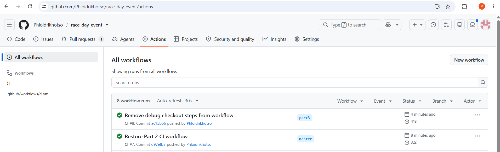

# RaceDay Event

A web system for managing road running, walking and cycling events in South Africa. Organizers create events and the distances people can enter, participants enrol, and organizers capture the results afterwards. The system has two parts: a REST API (Part 2) and an MVC web application that uses it (Part 3).

**Module:** PROG6212 Programming 2B (IIE), Portfolio of Evidence, Parts 2 and 3
**Author:** Phloid Rikhotso
**Branches:** Part 2 is on `master`, Part 3 is on `part3`

## The two roles

- **Organizer:** creates, edits and deletes their own events, adds categories (distances) to them, sees who enrolled, and captures results.
- **Participant:** browses open events, enrols under a category, cancels their own enrolment, and views their own enrolments and results.

Role is chosen from a dropdown when registering. Role checks are enforced in the API and reflected in the menus of the MVC app.

## Features

### API (Part 2)

- Register and log in with an email and password. Passwords are hashed with BCrypt.
- Organizers create events and add categories to them. A race can have several distances, and each distance has its own entry fee and participant limit.
- Participants browse open events, pick a category and enrol. They can cancel their own enrolment.
- Organizers see who enrolled in their events and capture each participant's finish time, position and result status.
- Participants view their own race history.

### API changes for Part 3

- The events list can be filtered.
- Each event shows how many people have enrolled.
- Results include the total number of finishers, so a position can be shown as "47th out of 312".
- Profiles return the user's role and their chosen avatar.

### MVC web application (Part 3)

The `race_day_mvc` project has no database access of its own. Every operation goes through the API, using one service class (`Services/api_client.cs`) that forwards the API session cookie.

**Participant pages**

- Home page with the upcoming events and filters
- Event details with the available categories and an enter-event form
- My enrolments, with the enrolment status
- My results, with finish time and position
- Profile, with the choice of profile picture

**Organizer pages**

- Dashboard with a summary of the organizer's events
- Events: create, edit and delete
- Categories: add distances to an event
- Enrolments: see who entered each event
- Results: capture finish times, positions and result status

Each role gets its own menu. Pages are protected by a session and role check, and logging out clears the session.

## Built with

- ASP.NET Core 8 (C#), Web API and MVC
- SQL Server LocalDB, using `System.Data.SqlClient` with parameterised queries
- BCrypt.Net-Next for password hashing
- Swagger (Swashbuckle) for trying out the API endpoints
- xUnit for the unit tests
- Bootstrap for the MVC layout
- GitHub Actions for CI

## Project structure

```
race_day_event/
├── Controllers/    API controllers: authenticator, users, events, categories, enrolments, results
├── Database/       classes that hold the SQL queries
├── Models/         data classes for the tables
├── Docs/           SQL script, API endpoint plan (with the ERD), CI screenshot
├── TestProject1/   xUnit unit tests (Part 2)
├── race_day_mvc/   ASP.NET Core MVC web application (Part 3)
│   ├── Controllers/    Account, Home, Participant, Organizer
│   ├── Services/       api_client, which calls the API
│   ├── Views/          Razor views for each controller
│   └── wwwroot/        styles, images and avatars
└── Program.cs      API setup (Swagger and session)
```

## Getting started

### What you need

- .NET 8 SDK
- SQL Server LocalDB (installed with Visual Studio)

### 1. Get the code

```bash
git clone https://github.com/Phloidrikhotso/race_day_event.git
cd race_day_event
git checkout part3
```

### 2. Create the database

The API connects to the LocalDB instance `api_both` and the database `raceday`.

```bash
sqllocaldb create api_both
sqllocaldb start api_both
sqlcmd -S "(localdb)\api_both" -i Docs/raceday_event.sql
```

The script creates the `raceday` database, all the tables, and the two roles (Organizer and Participant). You can also open `Docs/raceday_event.sql` in Visual Studio (SQL Server Object Explorer) and run it there.

The connection string is `Data source=(localdb)\api_both;database=raceday;`. It is stored in the classes in the `Database` folder, so change it there if you use a different instance name.

### 3. Run the API

```bash
dotnet run --project race_day_event.csproj
```

Swagger is at `https://localhost:7093/swagger`.

### 4. Run the MVC application

Leave the API running, then in a second terminal:

```bash
dotnet run --project race_day_mvc/race_day_mvc.csproj
```

Open `https://localhost:7104`. The API address is set in `race_day_mvc/appsettings.json` as `ApiBaseUrl` (`https://localhost:7093`), so change it there if your API runs on a different port.

In Visual Studio you can instead right-click the solution, choose **Configure Startup Projects**, and start both `race_day_event` and `race_day_mvc`.

## How logging in works

`POST api/authenticator/login` starts a session and stores the user's id and role. The other endpoints read the session to find out who is calling. The session ends when you log out, or after 5 minutes of no activity. The MVC app forwards the API's session cookie on every request, so the API still decides who is logged in. In Swagger the browser keeps the session cookie, so log out before you log in as a different user.

## API endpoints

### Authentication

| Method | Route | Who | What it does |
|---|---|---|---|
| POST | `/api/authenticator/register` | Anyone | Registers a user as an Organizer or Participant |
| POST | `/api/authenticator/login` | Anyone | Logs in with email and password |
| POST | `/api/authenticator/logout` | Logged in | Ends the session |

### Users

| Method | Route | Who | What it does |
|---|---|---|---|
| GET | `/api/users/me` | Logged in | Returns the logged-in user's profile |
| PUT | `/api/users/me` | Logged in | Updates the logged-in user's profile |

### Events

| Method | Route | Who | What it does |
|---|---|---|---|
| GET | `/api/events` | Anyone | Lists upcoming events that are open for enrolment |
| GET | `/api/events/mine` | Organizer | Lists the organizer's own events at any date or status |
| GET | `/api/events/{event_id}` | Anyone | Returns one event |
| POST | `/api/events` | Organizer | Creates an event |
| PUT | `/api/events/{event_id}` | Organizer (owner) | Updates an event |
| DELETE | `/api/events/{event_id}` | Organizer (owner) | Deletes an event |

### Categories (the distances of an event)

| Method | Route | Who | What it does |
|---|---|---|---|
| GET | `/api/events/{event_id}/categories` | Anyone | Lists the categories of an event |
| POST | `/api/events/{event_id}/categories` | Organizer (owner) | Adds a category with its own fee and distance |
| PUT | `/api/categories/{category_id}` | Organizer (owner) | Updates a category |
| DELETE | `/api/categories/{category_id}` | Organizer (owner) | Deletes a category |

### Enrolments

| Method | Route | Who | What it does |
|---|---|---|---|
| POST | `/api/events/{event_id}/enrolments` | Participant | Enrols in an event under a chosen category |
| GET | `/api/enrolments/me` | Participant | Lists the participant's own enrolments |
| GET | `/api/events/{event_id}/enrolments` | Organizer (owner) | Lists the participants enrolled in an event |
| DELETE | `/api/enrolments/{enrolment_id}` | Participant (owner) | Cancels the enrolment |

### Results

| Method | Route | Who | What it does |
|---|---|---|---|
| POST | `/api/enrolments/{enrolment_id}/result` | Organizer (owner) | Captures a result for an enrolment |
| PUT | `/api/enrolments/{enrolment_id}/result` | Organizer (owner) | Updates a captured result |
| GET | `/api/results/me` | Participant | Returns the participant's own results |
| GET | `/api/events/{event_id}/results` | Organizer (owner) | Returns all the results of an event |

"Owner" means the organizer who created the event.

### Response codes

Every endpoint returns a short text message. The status code tells you what happened:

| Code | Meaning |
|---|---|
| 200 | It worked (including deletes and cancellations) |
| 201 | Something was created |
| 400 | The input failed validation |
| 401 | Nobody is logged in |
| 403 | The user has the wrong role, or the item belongs to someone else |
| 404 | The event, category, enrolment or result does not exist |
| 409 | A conflict, for example already enrolled, category full, event not open, or duplicate category |

## Trying it out

1. Register one **Organizer** and one **Participant**.
2. Log in as the Organizer and create an event with the status **Open**.
3. Add one or more categories to the event, each with its own distance and fee.
4. Log out, then log in as the Participant, and open the event from the home page.
5. Enter the event under a category and check **My enrolments**.
6. Log out, log in as the Organizer, and open the event's enrolments. Capture a result for the enrolment.
7. Log in as the Participant again and open **My results**.

Race type, event status, category name and role are dropdowns. You can follow the same steps in Swagger instead of the MVC app.

## Running the tests

The unit tests are part of Part 2. They check the rules that run before the database is reached: being logged in, having the right role, and valid input. They don't need SQL Server.

In Visual Studio, open **Test Explorer** from the Test menu and choose **Run All Tests**. From the command line:

```bash
dotnet test TestProject1/TestProject1.csproj
```

## CI

The GitHub Actions workflow in `.github/workflows/main.yml` runs on every push to `master` and `part3`. It restores and builds the API and the MVC project, runs the unit tests, and publishes the API.



## Notes on the brief

- Azure Blob Storage and the Docker container were not required for Part 3, on the lecturer's instruction. There is no Dockerfile.
- Profile pictures are chosen from built-in avatars, and the avatar key is stored in `profile_picture_url`.

## Video

https://youtu.be/vrq6R2tPrng

## Documentation

The `Docs` folder holds:

- `raceday_event.sql`, the final database script
- the API endpoint plan, which also contains the ERD
- `ci-green.png`, the green CI build

## Use of AI tools
-Claude.ai
